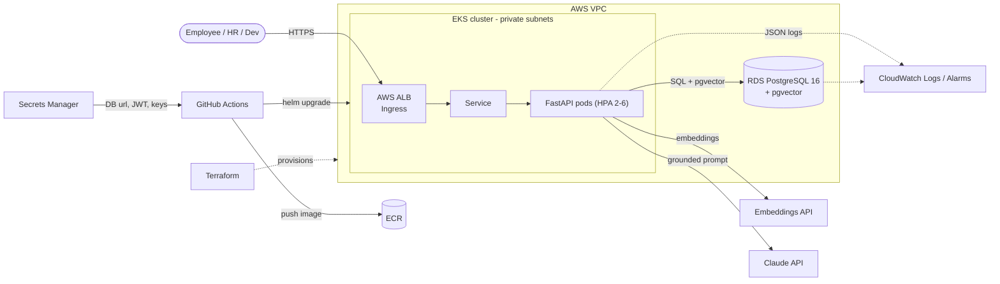
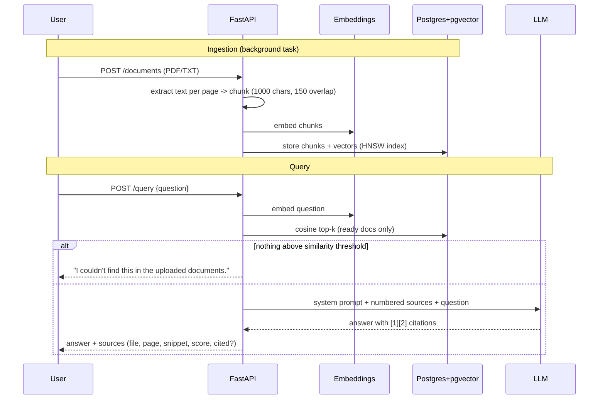

# 📚 Production RAG Knowledge Assistant

AI-powered document Q&A. Upload PDFs / text files (policies, manuals, runbooks, reports), ask questions in plain English, and get answers **grounded only in your documents**, each with **source citations** (document, page, passage).

**Stack:** Python + FastAPI · RAG + LLM (Claude) · PostgreSQL + pgvector · Docker/Compose · Terraform · GitHub Actions · Kubernetes + Helm · AWS (EKS, RDS, ECR, ALB, CloudWatch)

---

## Architecture



### RAG flow



## Requirement checklist

| Layer | Where |
|---|---|
| FastAPI, Pydantic, auth | `app/` – JWT (bcrypt + PyJWT), roles (first user = admin; only admins upload/delete) |
| RAG | `app/services/` – `chunking.py`, `embeddings.py`, `retrieval.py`, `llm.py`, `ingestion.py` |
| pgvector | `app/models.py` – `Vector(1536)` column + HNSW cosine index |
| Docker | `Dockerfile` (multi-stage, non-root), `docker-compose.yml` (db + api + optional pgAdmin) |
| Terraform | `terraform/` – VPC, EKS, RDS, ECR, IAM (GitHub OIDC), Secrets Manager, CloudWatch |
| CI/CD | `.github/workflows/ci-cd.yml` – lint+test → validate TF/Helm → build → push ECR → deploy |
| Helm | `helm/rag-assistant/` – Deployment, Service, ConfigMap, Secret, Ingress (ALB), HPA, PDB, ServiceAccount |
| Observability | JSON logs with request IDs, `/health` + `/ready`, Container Insights, alarms (errors, RDS CPU/storage) |

## 1. Run locally (5 minutes)

```bash
cp .env.example .env          # defaults: offline fake embeddings + mock LLM, no API keys needed
docker compose up --build
open http://localhost:8000    # web UI  (Swagger: /docs)
```

1. Register → the **first user becomes admin**. Login.
2. Upload a PDF/TXT, wait for status `ready`.
3. Ask a question → answer + sources.

For **real answers**, edit `.env`:
```
EMBEDDING_PROVIDER=openai   OPENAI_API_KEY=sk-...
LLM_PROVIDER=anthropic      ANTHROPIC_API_KEY=sk-ant-...
MIN_SIMILARITY=0.25
```
> If you change `EMBEDDING_DIM` / the embedding model, re-ingest documents (vectors from different models aren't comparable).

### API

| Method | Path | Auth | Purpose |
|---|---|---|---|
| POST | `/api/v1/auth/register` | – | create user |
| POST | `/api/v1/auth/login` | – | form login → JWT |
| GET | `/api/v1/auth/me` | user | current user |
| POST | `/api/v1/documents` | admin | upload (202, async ingest) |
| GET | `/api/v1/documents[/{id}]` | user | list / status |
| DELETE | `/api/v1/documents/{id}` | admin | delete doc + vectors |
| POST | `/api/v1/query` | user | ask a question |
| GET | `/health`, `/ready` | – | liveness / readiness |

```bash
TOKEN=$(curl -s -d 'username=me@x.com&password=supersecret1' localhost:8000/api/v1/auth/login | jq -r .access_token)
curl -H "Authorization: Bearer $TOKEN" -F file=@leave-policy.pdf localhost:8000/api/v1/documents
curl -H "Authorization: Bearer $TOKEN" -H 'Content-Type: application/json' \
     -d '{"question":"How many casual leaves do I get?"}' localhost:8000/api/v1/query
```

### Tests
```bash
make test     # starts pgvector Postgres, runs pytest (chunking, auth, full upload→cited-answer flow)
```

## 2. Provision AWS with Terraform

Prereqs: AWS credentials, Terraform ≥ 1.6, helm, kubectl.

```bash
cd terraform
cp terraform.tfvars.example terraform.tfvars   # set github_repo, alert_email
export TF_VAR_anthropic_api_key=sk-ant-... TF_VAR_openai_api_key=sk-...
terraform init && terraform apply              # ~20 min (EKS + RDS)
terraform output github_deploy_role_arn
```
Creates: VPC (public/private/database subnets, NAT) · EKS + managed node group · AWS Load Balancer Controller · metrics-server · RDS PostgreSQL 16 (private, encrypted) · ECR (scan on push, immutable tags) · Secrets Manager entry · GitHub OIDC deploy role · CloudWatch alarms + SNS.

Default region is `ap-south-1` (Mumbai). Enable the S3 backend block in `versions.tf` for team use.

## 3. CI/CD (GitHub Actions)

Add repo secret **`AWS_DEPLOY_ROLE_ARN`** (from Terraform output) and, optionally, a `production` environment with required reviewers.

```
PR:   lint + pytest (pgvector service) + terraform validate + helm lint
main: ... → build image → push to ECR (tag = git SHA) → helm upgrade --atomic (auto rollback on failure)
```
No AWS keys are stored in GitHub (OIDC). Runtime secrets are pulled from Secrets Manager during deploy and passed to Helm.

## 4. Deploy / inspect on Kubernetes

CI does this for you; manually:
```bash
$(terraform -chdir=terraform output -raw kubeconfig_command)
helm upgrade --install rag helm/rag-assistant -n rag --create-namespace \
  --set image.repository=<ecr-url> --set image.tag=<sha> -f secrets.json
kubectl -n rag get pods,svc,ingress,hpa
kubectl -n rag get ingress          # ALB DNS name = your app URL
kubectl -n rag logs deploy/rag-rag-assistant | jq .
```
Custom domain + HTTPS: set `ingress.host` and the ACM `certificate-arn` annotations in `values.yaml`.

## 5. Observability

- Structured JSON logs (`request_id`, `path`, `status`, `duration_ms`, `query_answered` with latency/hits).
- CloudWatch Logs Insights example:
  ```
  fields @timestamp, log | filter log like /query_answered/ | sort @timestamp desc
  ```
- Alarms → SNS email: app ERROR count, RDS CPU > 80 %, RDS free storage < 5 GB.

## Design decisions

- **Grounding:** temperature 0, strict system prompt, similarity floor — below it the LLM isn't called and the app says it couldn't find an answer. Retrieved text is delimited and marked as untrusted (prompt-injection hardening).
- **Citations:** chunks are numbered in the prompt; the response lists every retrieved source with `cited: true/false` based on `[n]` markers actually used.
- **Page-accurate sources:** PDFs are chunked per page, so page numbers are exact.
- **HNSW** index: no training step, good recall for incremental uploads.
- **Background ingestion** via FastAPI `BackgroundTasks` keeps the demo simple. For heavy load, move to a queue (SQS + worker Deployment).
- **Embeddings** are a separate provider from the LLM (Anthropic has no embeddings endpoint); swap by editing `services/embeddings.py`.

## Known limitations / next steps

- Scanned PDFs need OCR (Textract) – currently reported as a failed ingestion with a clear message.
- Add Alembic migrations (tables are created on startup via `create_all`).
- Per-team document ACLs (all authenticated users currently search all documents).
- Hybrid search (BM25 + vector) and a reranker for better recall.
- Rate limiting / WAF on the ALB; External Secrets Operator instead of CI-injected secrets.
- Cost note: EKS control plane + NAT + RDS cost money — run `terraform destroy` when finished.
